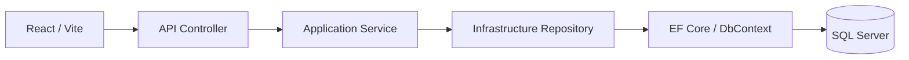

# Santos Conecta 2.0

**Serviços Próximos e aparência:** catálogo oficial no Flutter, mapa/lista, localização opcional e temas claro, escuro e automático no Flutter e no portal React do cidadão. [Entrega, fonte e validação](docs/SERVICOS-E-APARENCIA.md).

**Conecta, assistente do cidadão:** disponível no Flutter e no portal React em `/cidadao`. Consulta dados autorizados, oferece ações de navegação e identifica o modo orientativo quando a IA está indisponível. [Configuração, testes e limites](docs/CONECTA.md).

Atualização de 02/11/2026: cadastro e edição de funcionários em modal acessível; sino e notificações nos dois sentidos com leitura individual da equipe; trânsito TomTom real com fluxo, velocidades e incidentes. [Configuração e execução atualizadas](docs/TRANSITO-E-NOTIFICACOES.md). A configuração privada desta máquina mantém o nome `backend/SantosConecta.API/appsettings.Local.example.json`, carregado em Development e ignorado no Git. Aplique também `database/06-notificacoes.sql` em novas instalações sobre os scripts 01–05.

API: `npm.cmd run api` (5080). Painel: `npm.cmd run dev` → http://localhost:5173. Aplicativo: `npm.cmd run mobile:web:build` e `npm.cmd run mobile:web` → http://127.0.0.1:5200, com proxy para a mesma API na porta 5080.

Os registros de versões anteriores abaixo são históricos. Para os testes da atualização atual, consulte [docs/VALIDACAO.md](docs/VALIDACAO.md).

Evolução incremental com atendimento privado React/Flutter, gestão de funcionários com autorização no servidor, localização por bairro e rua, dashboard ampliado e tela de trânsito com integração TomTom desativada por padrão.

- [Entrega 2.0, configuração, decisões e limites](docs/SANTOS-CONECTA-2.md)
- [Testes executados e pendências](docs/VALIDACAO.md)
- [Scripts incrementais de equipe e mensagens](database/04-santos-conecta-v2.sql)
- [Script de localização confirmada](database/05-localizacao.sql)

Execute a API com `npm.cmd run api`, o painel com `npm.cmd run dev` e consulte o guia acima para Flutter. Aplique os scripts 04 e 05 sobre o banco já preparado pelos scripts 01–03. Não foram alteradas senhas existentes nem removidos registros. Não há vínculo oficial com a Prefeitura.

## Registro das versões anteriores

As descrições abaixo são históricas; o estado e os endpoints atuais estão no guia 2.0.

# Santos Conecta

## Atualização — painel, cidadãos e priorização territorial

**Teste o aplicativo no navegador sem Android Studio:** execute `npm.cmd run mobile:web:build` e `npm.cmd run mobile:web`, com a API C# na porta 5080. Abra `http://127.0.0.1:5200`. Passo a passo em [docs/FLUTTER.md](docs/FLUTTER.md).

O projeto existente foi ampliado com identidade verde e Montserrat local, aplicativo Flutter Android em `mobile/`, cadastro/login de cidadãos, isolamento das reclamações por sessão, Priorização Territorial Justa, fila administrativa, indicadores de equidade e classificação opcional via Groq no backend. A página Relatórios continua removida. É uma plataforma acadêmica fictícia, sem vínculo com a Prefeitura de Santos.

**A conexão real com o SQL Server foi confirmada nesta evolução e o script incremental `database/03-mobile-priorizacao.sql` foi aplicado, preservando os dados anteriores.** As falhas SSPI/TLS descritas no registro anterior abaixo ocorreram no executor restrito; o diagnóstico e os fluxos persistidos funcionaram fora do sandbox, sem alterar TLS ou permissões do servidor.

- [Entrega atual, API e execução](docs/EVOLUCAO.md)
- [Aplicativo Flutter: instalação, emulador e dispositivo físico](docs/FLUTTER.md)
- [Fórmula e limites da priorização territorial](docs/PRIORIZACAO.md)
- [Resultados reais e pendências desta evolução](docs/VALIDACAO-EVOLUCAO.md)

```powershell
npm.cmd run build
dotnet build SantosConecta.sln --no-restore
dotnet run --project tests/priority/PriorityChecks.csproj
npm.cmd run test:mobile
# Com API de teste na porta 5081 e SQL acessível:
npm.cmd run test:cidadao
```

O SDK Flutter local está em `.tools/flutter` e não é versionado. Android SDK/Android Studio ainda precisam ser configurados para APK e execução em aparelho. Groq real depende de `GROQ_API_KEY`; SMTP real depende das credenciais do provedor. Os indicadores territoriais iniciais são **SIMULAÇÃO ACADÊMICA**, sem valor estatístico oficial.

---

## Documentação da versão anterior (preservada)

As observações de indisponibilidade e contagens de testes abaixo registram a versão anterior; para o estado atual use os documentos acima.

Sistema acadêmico de atendimento e gestão de reclamações urbanas de Santos/SP, desenvolvido para a **empresa fictícia Conecta Soluções Urbanas**. Não é um serviço da Prefeitura de Santos e não contém reclamações reais de cidadãos.

O React existente foi preservado e integrado a uma Web API. Relatórios e contato por aplicativo de mensagens foram retirados. A comunicação agora é por e-mail, sempre com revisão humana. Não há persistência de reclamações ou autenticação simulada em localStorage.

## Estado da entrega e validação

- Frontend: TypeScript e build de produção verificados.
- Backend: os quatro projetos compilados para **.NET 8** com SDK 10 disponível, sem erros ou avisos.
- API iniciada em `http://localhost:5080`; Swagger respondeu HTTP 200.
- Nove verificações HTTP básicas aprovadas: contrato OpenAPI, proteção sem sessão, validação de entrada e bloqueio de origem externa.
- Navegador: três testes aprovados; três testes de integração foram **ignorados explicitamente** porque o SQL Server não pôde ser autenticado.
- Nesta execução, `/health` retornou **503**. As instâncias locais estavam em execução, mas as conexões apresentaram erros **SSPI / credenciais indisponíveis** e indisponibilidade da camada TLS nativa neste ambiente. Não foi possível aplicar os scripts, popular o banco ou validar os fluxos persistidos. Esses fluxos não foram substituídos por mocks.
- SMTP real e Groq real não foram acionados: dependem de configuração externa. O teste de e-mail simulado com persistência também depende da conexão SQL.

Veja [docs/VALIDACAO.md](docs/VALIDACAO.md) para distinguir o que foi executado do que permanece pendente. Após configurar uma conexão válida, rode os testes descritos abaixo. **Compilar não comprova funcionamento integrado com o banco.**

## Tecnologias e arquitetura

- React, Vite 8, TypeScript, Tailwind CSS, Lucide, React Router e TanStack Query.
- Leaflet/React Leaflet com OpenStreetMap, agrupamento de marcadores e calor; Recharts nos gráficos do painel.
- ASP.NET Core Web API .NET 8, Controllers, Data Annotations, DI, EF Core e SQL Server.
- Swagger/OpenAPI; autenticação por cookie do ASP.NET Core e `PasswordHasher<Funcionario>`.
- SMTP com `System.Net.Mail`; Groq com `HttpClient` no servidor.



```text
SantosConecta.sln
backend/
  SantosConecta.API/             Controllers, Program.cs, CORS, Swagger e autenticação
  SantosConecta.Application/     DTOs, validações e serviços de negócio
  SantosConecta.Domain/          Entidades e interfaces de repositórios
  SantosConecta.Infrastructure/  DbContext, repositórios, seed, SMTP e Groq
database/                       Banco e três procedures
src/                            Frontend existente, componentes, páginas, contexto e serviços HTTP
tests/                          Testes Playwright com API real
scripts/                        Inicialização e verificações
docs/                           Scrum e registro de validação
```

Não há microserviços, CQRS, Generic Repository, Unit of Work personalizado, Dapper ou camadas adicionais. As tabelas são criadas pelo SQL e **mapeadas manualmente no EF Core**, sem migrations concorrentes e sem `EnsureCreated`.

## Pré-requisitos

- Node.js 24 e npm.
- SDK .NET 8, ou SDK posterior capaz de compilar `net8.0`; runtime ASP.NET Core 8 para executar.
- SQL Server acessível e permissão para criar `SantosConectaDB`.
- SSMS ou `sqlcmd` para aplicar os scripts.
- Google Chrome para os testes Playwright configurados neste repositório.

## 0. Confirmar a conexão antes de alterar o banco

Com a Solution compilada, execute na raiz:

```powershell
npm.cmd run diagnosticar:sql
# Equivalente, sem recompilar:
dotnet run --project backend/SantosConecta.API --no-build --no-restore -- --diagnosticar-sql
```

O comando mostra apenas servidor, banco, modo de autenticação, ambiente e opções de TLS. Não imprime login SQL ou senha. Ele tenta abrir `master`, depois o banco configurado e finalmente consulta contagens com o DbContext. Não executa DDL, seed ou gravações. Código de saída 0 indica diagnóstico completo; 2 indica falha, com etapa e exceção detalhadas no terminal.

**Não execute scripts ou seed enquanto a etapa 1 não confirmar uma conexão autenticada real.** Se o servidor conectar, mas o banco ou as tabelas não existirem, verifique essa condição no SSMS antes da preparação abaixo. Se já houver dados, preserve-os; o seed recusa substituí-los.

## 1. Preparar o banco

Após confirmar a conexão, no SSMS, conecte-se à sua instância e execute, se a estrutura ainda precisar ser criada, nesta ordem:

1. [database/01-banco.sql](database/01-banco.sql).
2. [database/02-procedures.sql](database/02-procedures.sql).

Alternativa pelo PowerShell, usando autenticação Windows:

```powershell
sqlcmd -S localhost -E -C -f 65001 -b -i database/01-banco.sql
sqlcmd -S localhost -E -C -f 65001 -b -i database/02-procedures.sql
```

Troque `localhost` pela instância utilizada no SSMS, por exemplo `localhost\MSSQLSERVER01`. Os scripts não apagam dados existentes; a criação de cada tabela é condicionada à sua ausência. As procedures usam `CREATE OR ALTER`.

Se a autenticação Windows falhar com SSPI, confirme a instância e as permissões com o administrador local ou utilize um login SQL autorizado. Não compartilhe senhas no chat nem as coloque no Git.

### Conexão da API

A configuração Development usa Windows Authentication em `tcp:PCEDUARDO,1433`, apontando explicitamente para a instância padrão `MSSQLSERVER` no servidor informado. O serviço e a porta foram identificados nesta máquina; outra instalação pode usar endereço diferente. Para alterar a conexão de desenvolvimento, configure uma variável **no terminal do backend**:

```powershell
$env:ConnectionStrings__SantosConecta = 'Server=tcp:PCEDUARDO,1433;Database=SantosConectaDB;Integrated Security=True;Encrypt=True;TrustServerCertificate=True;Connect Timeout=5'
```

Com autenticação SQL, utilize um login já autorizado e uma string com `Integrated Security=False`, `User ID` e `Password` em variável de ambiente local. Outra opção, apenas em Development, é copiar `backend/SantosConecta.API/appsettings.Local.example.json` para `appsettings.Local.json` na mesma pasta e configurar ali a conexão. O arquivo local é ignorado pelo Git. Variáveis de ambiente têm precedência sobre esse arquivo. Não altere o modo de autenticação da instância nem crie logins amplamente privilegiados para contornar uma falha do executor.

`Encrypt=True` permanece habilitado. A exceção `TrustServerCertificate=True` fica em `appsettings.Development.json`; a configuração base usa False e a API rejeita True fora de Development. O arquivo `appsettings.Local.json` também é carregado somente em Development. `TrustServerCertificate` trata a validação do certificado, não cria credenciais Windows nem corrige a indisponibilidade de SSPI/Schannel. Não houve alteração de TLS, certificados, SPNs ou políticas globais do Windows.

O diagnóstico desta execução continua falhando antes da primeira consulta, na abertura de `master`: erro SQL 20 de TLS, acompanhado por falha SSPI no teste separado de autenticação Windows. A porta TCP responde, mas isso não comprova login no SQL. Consulte [docs/VALIDACAO.md](docs/VALIDACAO.md) para mensagens completas e próximos testes sob uma identidade Windows autorizada.

## 2. Restaurar, compilar e popular

Na raiz do projeto:

```powershell
$env:DOTNET_CLI_HOME = Join-Path $PWD '.dotnet-home'
dotnet restore SantosConecta.sln
dotnet build SantosConecta.sln --no-restore
```

Depois de criar o banco e configurar a conexão, escolha uma senha local de pelo menos 12 caracteres para os funcionários fictícios:

```powershell
$env:Seed__Password = 'substitua-por-uma-senha-local'
dotnet run --project backend/SantosConecta.API --no-restore -- --seed
```

O seed usa EF Core e uma transação para inserir **132 reclamações fictícias, 24 cidadãos, cinco funcionários, dez categorias e históricos**. Não envia e-mails. Ele recusa execução se já houver cidadãos, funcionários ou ocorrências, preservando os dados existentes.

Contas iniciais:

- Administrador: `ana.silva@exemplo.invalid`.
- Funcionário: `funcionario1@exemplo.invalid` (também existem 2, 3 e 4).
- Senha: a definida em `Seed__Password`; somente o hash é armazenado.

Os cidadãos usam `@exemplo.invalid` e telefone inválido. Os protocolos começam com `DEMO-`. Os pontos aproximados ficam distribuídos em onze bairros de Santos, sem polígonos oficiais ou associação a reclamações reais. Confira os centros no [OpenStreetMap](https://www.openstreetmap.org/#map=13/-23.9595/-46.3265).

### Restauração em ambiente com erro TLS do NuGet

Na execução automatizada deste ambiente Windows, o cliente TLS do NuGet não conseguiu autenticar. Foi utilizado um feed local de pacotes oficiais baixados por HTTPS com o Node e os certificados do sistema:

```powershell
$env:NODE_USE_SYSTEM_CA = '1'
node scripts/restore-nuget.mjs
# Pacotes de referência solicitados pelo SDK 10.0.401 desta máquina:
node scripts/restore-nuget.mjs Microsoft.NETCore.App.Ref@8.0.31 Microsoft.AspNetCore.App.Ref@8.0.31 Microsoft.WindowsDesktop.App.Ref@8.0.31 Microsoft.NETCore.App.Host.win-x64@8.0.31
dotnet restore SantosConecta.sln --source .nuget/feed -p:NuGetAudit=false
```

Essa alternativa não é parte da arquitetura da aplicação e normalmente não é necessária em outro computador. A auditoria de vulnerabilidades não é executada no restore offline; faça a auditoria com a origem oficial quando o acesso normal estiver disponível. Não desative a validação TLS.

## 3. Iniciar a API

```powershell
dotnet run --project backend/SantosConecta.API --no-restore
```

Ou `npm.cmd run api` depois da restauração. Endereços:

- API: `http://localhost:5080`.
- Swagger: `http://localhost:5080/swagger`.
- Saúde da conexão: `http://localhost:5080/health` — 200 conectado, 503 indisponível.

O Swagger é habilitado no ambiente Development do perfil de execução. Faça `POST /api/auth/login` com `email` e `senha` para obter o cookie antes de testar endpoints protegidos. Não é necessário colar tokens. O cookie é HttpOnly; em produção a política exige HTTPS. O login tem um limite simples de tentativas por endereço IP.

## 4. Iniciar o frontend

Em outro terminal, na mesma raiz:

```powershell
npm.cmd install
npm.cmd run dev
```

Abra `http://localhost:5173` ou a URL exibida pelo Vite. `npm.cmd` evita bloqueios de `npm.ps1` no PowerShell.

Com `VITE_API_URL` vazio, o navegador utiliza `/api` e o proxy do Vite encaminha para `http://localhost:5080`. Isso mantém a mesma origem para cookies durante o desenvolvimento. Para uma URL direta, configure `VITE_API_URL` em `.env` e use o **mesmo hostname** no frontend e no backend: não misture `localhost` e `127.0.0.1` em chamadas diretas com cookie. Ajuste `AllowedOrigins` no backend caso altere a porta do frontend.

O `.env.backend.example` é somente uma referência das variáveis do servidor; **o ASP.NET Core não carrega arquivos .env automaticamente**. Nunca copie segredos de SMTP ou Groq para variáveis `VITE_`.

Em Development, a API autoriza as portas 5173 e 5174 em localhost e 127.0.0.1, pois o Vite pode usar 5174 quando 5173 estiver ocupada. Após alterar AllowedOrigins, pare a API com Ctrl+C e inicie-a novamente. Um erro 403 antes da verificação da senha pode indicar uma origem não autorizada, e não comprova senha incorreta.

Para abrir em um celular na mesma rede, mantenha `VITE_API_URL` vazio, execute `npm.cmd run dev -- --host 0.0.0.0` e abra `http://IP_DO_COMPUTADOR:5173` no celular. Antes de iniciar a API, adicione essa origem em `$env:AllowedOrigins__2='http://IP_DO_COMPUTADOR:5173'`. O firewall local deve permitir a porta do Vite. Nesta entrega, a responsividade foi verificada em viewport móvel; acesso por um aparelho físico não foi testado.

Se o npm apresentar o erro de certificado observado neste ambiente, execute `$env:NODE_USE_SYSTEM_CA='1'` e depois `npm.cmd install --cache .npm-cache`. As dependências do frontend desta entrega já foram instaladas.

## Uso da plataforma

- Login com autenticação no SQL Server; perfil obtido do cadastro, sem seletor de perfil no cliente.
- Painel com total, aguardando análise (Aberta + Em análise), em andamento e resolvidas, consultados pela API; filtros por status e prioridade.
- Mapa com coordenadas do banco, agrupamento, calor, legenda, contagem na área visível e acesso ao protocolo.
- Lista com busca, filtros, ordenação, paginação, cartões/tabela e CSV dos registros.
- Cadastro de reclamação e cidadão, edição, atribuição, prioridade, status e observações com histórico.
- Seção **Responder ao cidadão**, com nome, destinatário, protocolo, assunto, texto editável, sugestão assistida e envio manual por e-mail.
- Histórico de e-mails do SQL Server, com resultado de cada tentativa.
- Visão da equipe para Administrador; ambos os perfis podem consultar responsáveis e atender reclamações. Não há endpoint de edição de funcionários nesta entrega.
- Navegação e formulários responsivos. Tabelas usam rolagem horizontal em telas pequenas.

Após uma gravação, o TanStack Query invalida as consultas de reclamações, dashboard e comunicação. As telas recebem o resultado persistido; falhas não produzem alterações locais fictícias. Se o banco estiver indisponível, o sistema mostra erro. O mapa base e a fonte Inter precisam de internet; há fonte sans-serif de fallback. Anexos não são armazenados neste escopo.

## E-mail SMTP

Por padrão, `Email:Simular=true`: a API registra `Simulado` com `DataEnvio=NULL`; nenhum SMTP é acionado.

Para usar um servidor SMTP autorizado, configure no terminal do backend e reinicie a API:

```powershell
$env:Email__Simular = 'false'
$env:SMTP_HOST = 'seu-servidor-smtp'
$env:SMTP_PORT = '587'
$env:SMTP_ENABLE_SSL = 'true'
$env:SMTP_FROM = 'seu-remetente-autorizado'
$env:SMTP_USER = 'seu-usuario'
$env:SMTP_PASSWORD = 'sua-senha-local'
```

O serviço usa SMTP com STARTTLS quando SSL está habilitado. O endereço e as credenciais devem ser do provedor utilizado. A chave/senha permanece no backend.

Antes do SMTP, a tentativa é gravada como `Pendente`. Depois:

| Resultado | StatusEnvio | DataEnvio |
|---|---|---|
| Modo de desenvolvimento | Simulado | NULL |
| Servidor SMTP aceitou a mensagem | Enviado | Horário UTC |
| Erro ou timeout SMTP | Falhou | NULL |

O erro é registrado e a API retorna 502 quando o envio falha. Aceitação SMTP não comprova entrega na caixa postal. Se houver interrupção entre o SMTP e a atualização do banco, a tentativa pode permanecer Pendente e deve ser conferida antes de repetir; não há fila ou reenvio automático.

## Groq

Por padrão, `Groq:Simular=true`: uma sugestão contextual é produzida **no backend** e identificada como simulada. Para utilizar a integração:

```powershell
$env:Groq__Simular = 'false'
$env:GROQ_API_KEY = 'configure-a-chave-somente-neste-terminal'
$env:Groq__Model = 'openai/gpt-oss-20b'
```

Reinicie a API. `GroqService` usa `HttpClient` e o endpoint oficial de chat completions. O modelo é configurável, pois a disponibilidade pode mudar. O serviço recebe nome, descrição, bairro, categoria, status e protocolo do registro consultado no banco. Não envia o e-mail do cidadão à IA.

As instruções proíbem prazos inventados, equipes não confirmadas e promessas de serviço; a mensagem sempre exige revisão humana. O assistente não envia e-mails automaticamente. Se a integração real estiver habilitada sem chave válida, a API apresenta erro e não afirma ter consultado a IA. Consulte a [documentação oficial da Groq](https://console.groq.com/docs/text-chat).

## Banco e conceitos para apresentação

| Tabela | Papel e relacionamentos |
|---|---|
| Cidadao | Identifica o autor; um cidadão pode ter várias reclamações. |
| Funcionario | Conta, hash de senha e perfil; responsável e autor das movimentações. |
| Categoria | Classifica as reclamações. |
| Ocorrencia | Protocolo único, localização, status e vínculos com cidadão, categoria e responsável opcional. |
| HistoricoOcorrencia | Movimentações com reclamação, funcionário, descrição e horário UTC. |
| EmailEnviado | Tentativas e resultados de comunicação, vinculados à reclamação e ao funcionário. |

- **Controller:** recebe a requisição HTTP, faz model binding e devolve 200, 201, 400, 401, 404 ou outro status adequado.
- **DTO e Data Annotations:** definem os campos de entrada e validam tamanho, e-mail, coordenadas e valores permitidos. Entidades com `SenhaHash` nunca são retornadas diretamente.
- **Service:** contém regras simples, como conferir relacionamentos, criar protocolo e registrar histórico.
- **Repository:** concentra consultas e gravações específicas de cada entidade, usando EF Core.
- **DbContext/DbSet:** representam a sessão de acesso ao banco e suas tabelas; o mapeamento define chaves e relacionamentos.
- **LINQ:** expressa filtros e consultas (`Where`, `FirstOrDefaultAsync`, `ToListAsync`) e agrupamentos. O EF parametriza as consultas enviadas ao SQL Server.
- **CRUD:** criar, consultar, atualizar e excluir. A API deste escopo expõe criação, consulta e atualização; o encerramento usa Cancelada para preservar o histórico. Não há exclusão física de reclamações.
- **API REST:** recursos acessados por URLs e verbos HTTP; GET consulta, POST cadastra/executa uma ação e PUT atualiza.
- **CORS:** autoriza as origens do frontend no navegador; não substitui autenticação. O pipeline também verifica Origin em mutações.
- **Injeção de dependência:** `Program.cs` associa interfaces às implementações; os Controllers recebem Services, que recebem Repositories.
- **Middleware:** etapas do pipeline para erros, CORS, limite de login, autenticação, autorização e roteamento.
- **Procedures:** rotinas SQL simples para listar por status, contar por bairro e atualizar status. Estão em `02-procedures.sql`; não há SQL dinâmico ou cursor. O fluxo da aplicação usa EF Core, incluindo o histórico; a procedure didática de atualização não registra histórico por si só.

Exemplos para apresentar as procedures no SSMS:

```sql
EXEC dbo.sp_ListarOcorrenciasPorStatus @Status = 'Aberta';
EXEC dbo.sp_ContarOcorrenciasPorBairro;
-- Usar somente um registro de demonstração para apresentar esta alteração direta:
-- EXEC dbo.sp_AtualizarStatusOcorrencia @IdOcorrencia = 1, @NovoStatus = 'Em análise';
```

## Endpoints

| Controller | Rotas principais |
|---|---|
| Auth | POST `/api/auth/login`, GET `/api/auth/me`, POST `/api/auth/logout` |
| Ocorrencias | GET/POST `/api/ocorrencias`, GET/PUT `/api/ocorrencias/{id}`, PUT `/{id}/status`, POST `/{id}/historico` |
| Cidadaos | GET/POST `/api/cidadaos`, GET `/api/cidadaos/{id}` |
| Funcionarios | GET `/api/funcionarios`, GET `/api/funcionarios/{id}` |
| Categorias | GET `/api/categorias` |
| Dashboard | GET `/api/dashboard/resumo`, GET `/api/dashboard/bairros` |
| Emails | POST `/api/emails/enviar`, GET `/api/emails/ocorrencia/{id}` |
| Assistente | POST `/api/assistente/gerar-resposta` |
| Configuracoes | GET `/api/configuracoes` — somente os indicadores de modo simulado, sem segredos |

O Swagger contém os modelos e as validações. Todos os recursos de negócio exigem sessão. O frontend adapta os DTOs em português aos componentes já existentes.

## Testes e apresentação

```powershell
npm.cmd run typecheck
npm.cmd run build
dotnet build SantosConecta.sln --no-restore
npm.cmd run test:api
npm.cmd test
```

Com o banco acessível e o seed executado, configure antes dos testes integrados:

```powershell
$env:E2E_EMAIL = 'ana.silva@exemplo.invalid'
$env:E2E_PASSWORD = 'a-mesma-senha-definida-no-seed'
npm.cmd run test:api
npm.cmd test
```

O script de API retorna código 2 se não puder executar a parte autenticada por falta de banco ou senha. `node scripts/test-api.mjs --allow-unavailable-db` executa somente o que for verificável e mantém as pendências explícitas no relatório. Os testes Playwright ignoram os fluxos SQL quando a conexão ou a credencial estiver ausente. Não inserem respostas falsas no navegador.

Os testes integrados criam cidadãos/reclamações fictícios adicionais e finalizam seus registros como Cancelada, sem apagar histórico. O teste de e-mail exige os modos simulados; não realiza envios externos. Para verificar o ramo de falha SMTP, em um ambiente de teste com SQL disponível, use uma API separada com `Email__Simular=false`, `SMTP_HOST=127.0.0.1`, uma porta local sem servidor, `SMTP_FROM=teste@exemplo.invalid` e `SMTP_ENABLE_SSL=false`; execute `node scripts/test-api.mjs --test-smtp-failure` apontando `API_TEST_URL` para essa API. O esperado é 502, Falhou e DataEnvio nula.

Roteiro da apresentação: login → cadastrar reclamação → alterar status/responsável → consultar histórico → verificar indicadores/mapa → gerar sugestão → revisar e-mail → simular envio → mostrar resultado no SQL Server e contrato no Swagger.

O planejamento de duas sprints e o backlog estão em [docs/SCRUM.md](docs/SCRUM.md). Referências: [ASP.NET Core](https://learn.microsoft.com/aspnet/core/), [EF Core](https://learn.microsoft.com/ef/core/) e [React Leaflet](https://react-leaflet.js.org/docs/api-map/).
# Travessia Santos?Guaruj?

A se??o mobile consulta a p?gina oficial da [AcquaVias](https://acquavias.com.br/santos-guaruja/) pelo backend, com cache e atualiza??o peri?dica. Tempos, embarca??es e avisos operacionais s?o extra?dos do HTML p?blico. O site n?o informa o hor?rio original da medi??o; o aplicativo identifica quando a p?gina foi consultada. Consulte [integra??o, fonte e limita??es](docs/travessia-acquavias.md). Testes espec?ficos: `dotnet run --project tests/ferry`.
